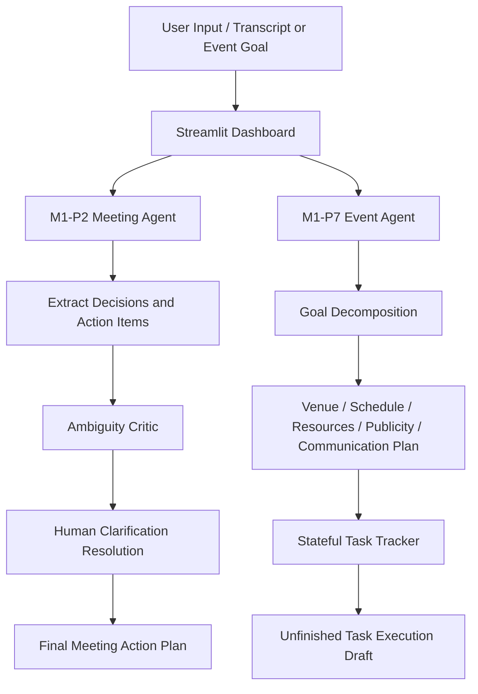

# Agentic AI Project 01

This repository implements two agentic AI projects as a unified Streamlit application:

- M1-P2: AI-Powered Meeting-to-Action Assistant
- M1-P7: Autonomous Event Planning Agent

## Project Overview

### 1) M1-P2: Meeting-to-Action Assistant
This agent reads a meeting transcript, extracts firm decisions and action items, identifies ambiguous or incomplete tasks, and prompts the user for missing details before finalizing the action plan.

### 2) M1-P7: Autonomous Event Planning Agent
This agent decomposes a high-level event requirement into team planning tasks, organizes venue, resource, publicity, and communication plans, and tracks unfinished activities using persistent `st.session_state` memory.

## Features

- Gemini API integration with `google-genai`
- Pydantic schema enforcement for structured outputs
- Offline Viva demo mode with deterministic fallback data
- Streamlit multi-agent dashboard interface
- Human-in-the-loop clarification for ambiguous meeting tasks
- Stateful event planning tracker and unfinished-task drafts

## Quickstart

```bash
pip install -r requirements.txt
streamlit run app.py
```

## Architecture



## Repository Structure

```text
.
├── app.py
├── m1_p2_meeting_agent.py
├── m1_p7_event_agent.py
├── requirements.txt
├── .gitignore
├── README.md
├── PROJECT_REPORT.md
```

## Environment Setup

Create a `.env` file with your Gemini API key if you want live model execution:

```env
GEMINI_API_KEY=your_api_key_here
```

If no API key is available, enable the sidebar `Offline Viva Demo Mode` and the app will run with deterministic fallback data.

## Evaluation Highlights

- Structured output using `BaseModel` validation
- Multi-agent decomposition and planning flow
- Human-in-the-loop correctness enforcement
- Resume-friendly Viva-ready design
